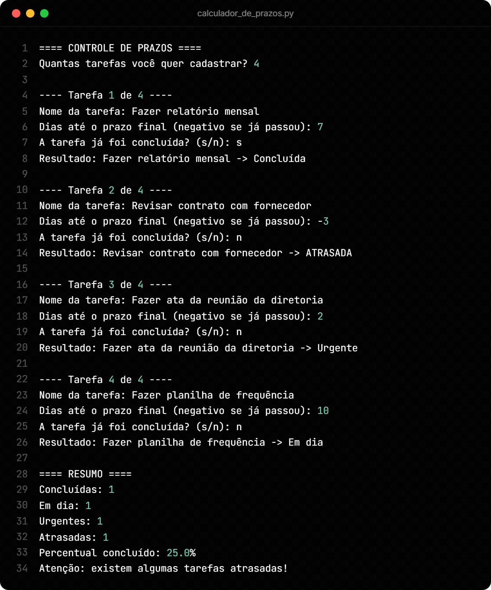
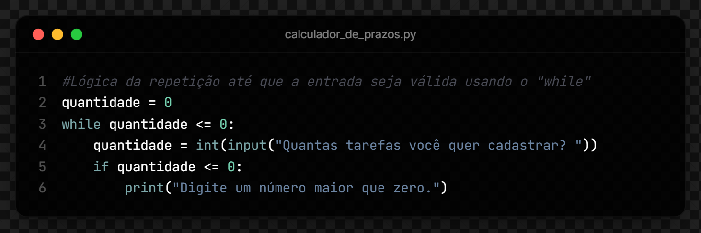
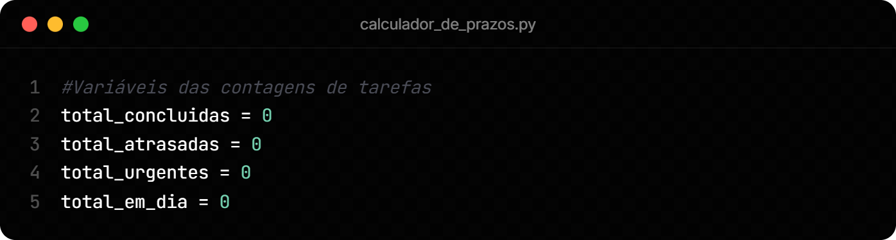
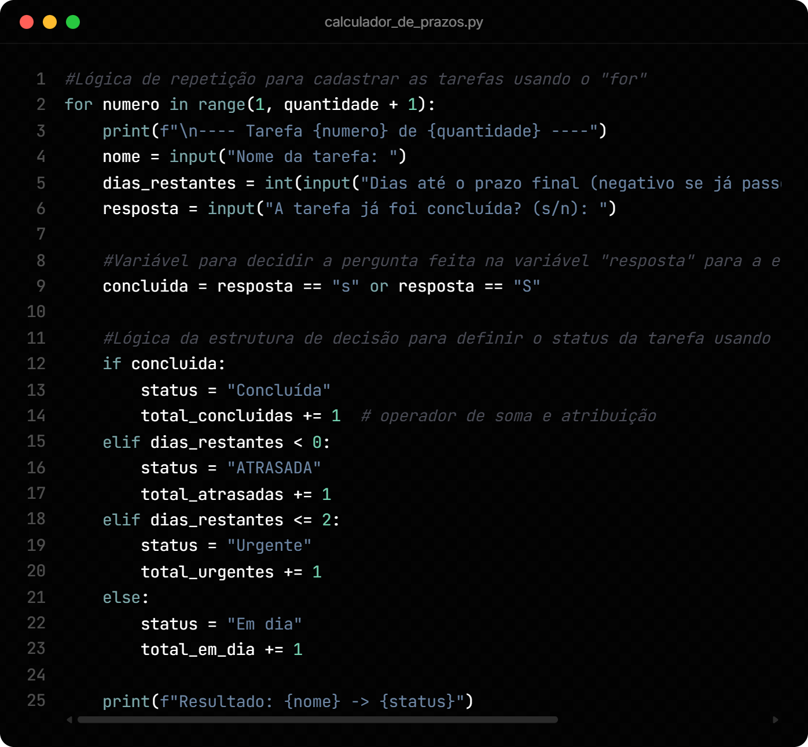
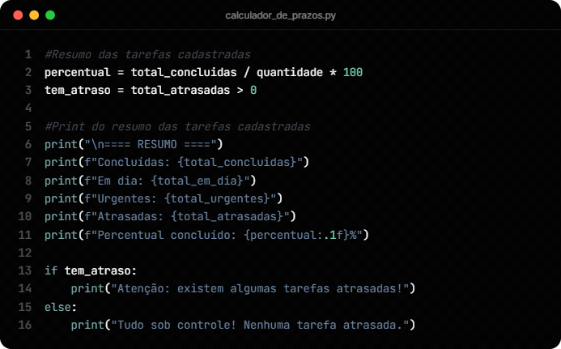

# Controle de Prazos em Python

Esse é um script que recebe uma lista de tarefas depois classifica cada uma como **concluída**, **em dia**, **urgente** ou **atrasada** e mostra um resumo no final.

Foi produzido como uma atividade prática para consolidar os fundamentos basicos de Python: sintaxe, variáveis, booleanos, operadores, estruturas de decisão e estruturas de repetição.

## Como executar

Com o Python instalado, abra o terminal na pasta do projeto e rode:

```bash
python calculador_de_prazos.py
```

## Exemplo de uso



## Como o código funciona

### 1. Validação da quantidade de tarefas (`while`)

O programa pergunta quantas tarefas serão cadastradas e repete a pergunta até receber um número maior que zero. Se o número for zero ou negativo irá mostrar "Digite um número maior que zero." e fará a pergunta de novo.



**Conceitos:** variáveis, `input()`, conversão com `int()`, operador de comparação `<=`, estrutura de repetição `while`.

### 2. Contadores

Quatro variáveis (`total_concluidas`, `total_atrasadas`, `total_urgentes` e `total_em_dia`) começam em zero e guardam quantas tarefas caem em cada status.



**Conceitos:** variáveis e atribuição.

### 3. Cadastro e classificação das tarefas (`for`, booleano e `if`,`elif`,`else`)



**Cadastro (`for`):** um laço `for numero in range(1, quantidade + 1)` repete o cadastro uma vez para cada tarefa: nome, dias até o prazo (negativo se o prazo já passou) e se foi concluída.

**Booleano:** a resposta "s" ou "S" vira um valor `True` ou `False` na variável `concluida`.

**Decisão do status:** a ordem das condições é importante. Primeiro irá verificar se a tarefa foi concluída, depois se está atrasada (quando inserido um prazo negativo), depois se é urgente (até 2 dias) e por fim, considera em dia. Em cada caso o contador correspondente aumenta com `+= 1` e o programa mostra `Resultado: <nome> -> <status>`.

| Condição (nesta ordem) | Status | Contador |
| --- | --- | --- |
| `concluida` é `True` | Concluída | `total_concluidas` |
| `dias_restantes < 0` | ATRASADA | `total_atrasadas` |
| `dias_restantes <= 2` | Urgente | `total_urgentes` |
| qualquer outro caso | Em dia | `total_em_dia` |

**Conceitos:** `for` com `range()`, f-strings, entrada de dados, booleanos, operador de igualdade `==`, operador lógico `or`, estrutura de decisão, operadores de comparação e o operador `+=`.

### 4. Resumo final

O programa calcula o percentual de tarefas concluídas, mostra as contagens e avisa se existe alguma tarefa atrasada.



**Conceitos:** operadores aritméticos (`/` e `*`), formatação com `:.1f`, booleano `tem_atraso`.

## Limitações atuais do código

- Se for digitado texto onde se espera número, o programa irá encerrar com erro.
- Qualquer resposta diferente de "s" ou "S" (até mesmo "sim") é considerada como tarefa não concluída.
- As tarefas não ficam salvas depois que o programa termina.

## Próximos passos

- Refatorar o código usando funções.
- Guardar as tarefas em listas.
