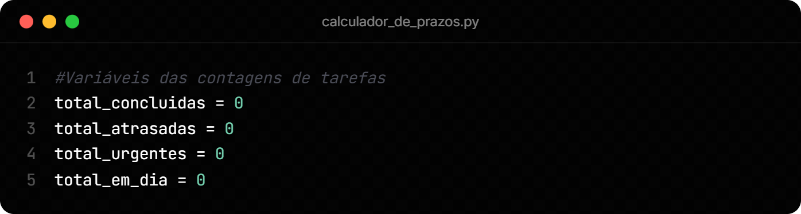
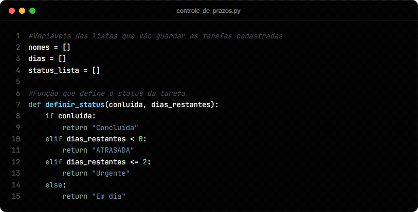
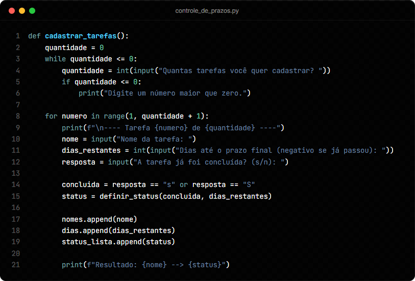
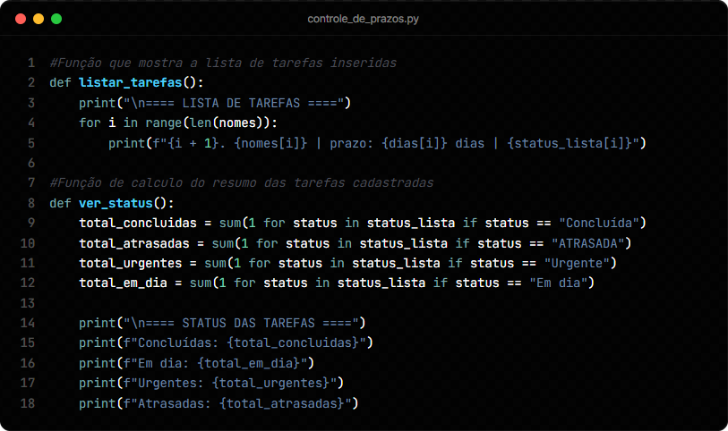

# Controle de Prazos em Python

Script que recebe uma lista de tarefas, classifica cada uma como **concluída**, **em dia**, **urgente** ou **atrasada** e mostra um resumo no final.

Foi feito como atividade prática para consolidar os fundamentos de Python: sintaxe, variáveis, booleanos, operadores, estruturas de decisão e repetição e, na segunda versão, **listas e funções**.

## Como executar

Com o Python instalado, abra o terminal na pasta do projeto e rode:

```bash
python calculador_de_prazos.py
```

## Exemplo de uso


---

## 🔄 Antes e depois da refatoração

| | ❌ Antes (versão 1) | ✅ Depois (versão 2) |
| --- | --- | --- |
| **Estrutura** | Um único bloco de código, de cima para baixo | Funções com uma responsabilidade cada |
| **Armazenamento** | Só contadores (`total_concluidas`, `total_atrasadas`...) | Listas (`nomes`, `dias`, `status_lista`) guardam cada tarefa |
| **Status da tarefa** | `if/elif/else` dentro do `for`, misturado com o cadastro | Função `definir_status()` que devolve o status com `return` |
| **Contagem** | Contadores somados com `+= 1` durante o cadastro | Calculada sob demanda com `sum()` sobre `status_lista` |
| **Interação** | Roda uma vez e encerra | Menu em loop: listar, ver status, resumo, cadastrar mais |
| **Divisão no percentual** | Seguro só porque o `while` garantia `quantidade > 0` | Protegido na própria função: `if quantidade > 0 else 0` |
| **Dados após o cadastro** | Perdidos, só sobram os totais | Ficam nas listas e podem ser listados |

### 1. Guardar os dados: contadores → listas

**Antes:** quatro contadores que só sabiam *quantas* tarefas havia em cada status. O nome e o prazo de cada tarefa eram perdidos.



**Depois:** três listas paralelas. A posição `i` guarda o nome, o prazo e o status da mesma tarefa.



### 2. Definir o status: `if/elif/else` solto → função

**Antes:** a decisão ficava dentro do `for`, junto com a entrada de dados e os contadores.


**Depois:** a regra virou `definir_status()` (primeira imagem acima, a partir da linha 7). Ela recebe `conluida` e `dias_restantes` e **devolve** o status. A ordem das condições continua importante:

| Condição (nesta ordem) | Status devolvido |
| --- | --- |
| `conluida` é `True` | Concluída |
| `dias_restantes < 0` | ATRASADA |
| `dias_restantes <= 2` | Urgente |
| qualquer outro caso | Em dia |

### 3. Cadastro: `cadastrar_tarefas()`

O `while` que valida a quantidade e o `for` que cadastra cada tarefa foram para dentro de uma função. Em vez de somar contadores, cada tarefa é guardada nas listas com `append()`, e o status vem de `definir_status()`.



### 4. Consultas: listar, status e resumo

Como os dados agora ficam guardados, é possível **consultá-los** depois do cadastro:

- `listar_tarefas()` percorre as listas e mostra cada tarefa com seu prazo e status.
- `ver_status()` conta quantas tarefas existem em cada status.



- `mostrar_resumo()` calcula o percentual concluído e avisa se existe tarefa atrasada.


### 5. Programa principal: menu em loop

O programa deixou de rodar uma vez e acabar. Um `while True` pergunta o que o usuário quer fazer e só termina quando ele escolher finalizar.


Se o usuário não finalizar, aparece um menu de outras opções:


**Conceitos novos:** listas, `append()`, `len()`, `sum()` com expressão geradora, funções com `def` e `return`, parâmetros, `while True` com `break`, `.lower()`.

---

## Versão 1: como o código original funcionava

<details>
<summary>Ver a explicação da primeira versão</summary>

### Validação da quantidade (`while`)

O programa pergunta quantas tarefas serão cadastradas e repete a pergunta até receber um número maior que zero.


### Cadastro e classificação (`for` e `if`/`elif`/`else`)

Um `for numero in range(1, quantidade + 1)` repetia o cadastro para cada tarefa. A resposta "s" ou "S" virava o booleano `concluida`, e a cadeia `if/elif/else` definia o status e somava no contador correspondente.

### Resumo final


</details>

## Limitações atuais do código

- Se for digitado texto onde se espera número, o programa encerra com erro.
- Qualquer resposta diferente de "s" ou "S" (até "sim") é considerada como tarefa não concluída.
- As tarefas continuam não sendo salvas depois que o programa termina.
- No menu "Outras opções", a opção `2 - Voltar ao resumo` apenas reinicia o loop.
- O parâmetro de `definir_status` está escrito `conluida` (falta o "c"). Funciona, mas vale corrigir.

## Próximos passos

- ~~Refatorar o código usando funções.~~ ✅
- ~~Guardar as tarefas em listas.~~ ✅
- Tratar entradas inválidas com `try`/`except`.
- Salvar as tarefas em arquivo.
- Permitir editar e remover tarefas.
