# Controle de Prazos em Python

Programa de terminal que cadastra tarefas, classifica cada uma como **concluída**, **em dia**, **urgente** ou **atrasada** e mostra um resumo. As tarefas ficam salvas em arquivo e podem ser editadas e removidas.

Foi feito como atividade prática para consolidar os fundamentos de Python. O projeto evoluiu em três versões:

| Versão | O que foi feito | Conceitos praticados |
| --- | --- | --- |
| **1** | Cadastro, classificação e resumo em um único bloco de código | sintaxe, variáveis, booleanos, operadores, `if/elif/else`, `while`, `for` |
| **2** | Refatoração com listas e funções, e menu em loop | listas, `append()`, `len()`, `sum()`, `def`, `return`, `while True` com `break` |
| **3** | Entradas validadas, tarefas salvas em arquivo, editar e remover | `try`/`except`, `open()`, `split()`, `pop()` |

## Como executar

Com o Python instalado, abra o terminal na pasta do projeto e rode:

```bash
python calculador_de_prazos.py
```

Na primeira vez que uma tarefa for cadastrada, o arquivo `tarefas.txt` é criado na pasta de onde o comando foi executado.

## Regra de status

A função `definir_status()` avalia as condições nesta ordem, e a ordem importa:

| Condição | Status |
| --- | --- |
| tarefa concluída | Concluída |
| `dias_restantes < 0` | ATRASADA |
| `dias_restantes <= 2` | Urgente |
| qualquer outro caso | Em dia |

---

## Versão 1: tudo em um bloco

O programa rodava uma vez, de cima para baixo, e encerrava.

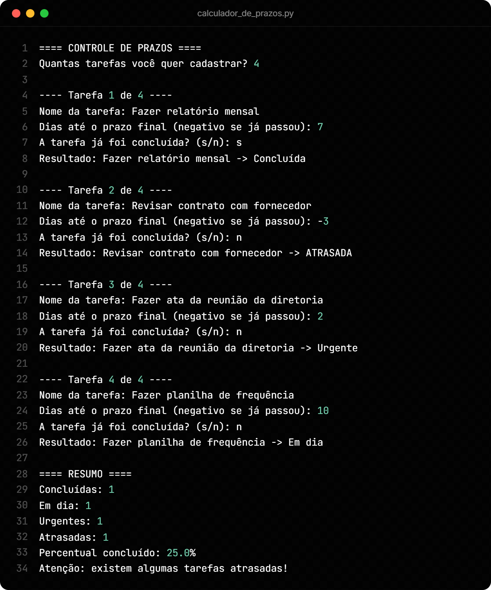

### Validação da quantidade (`while`)

Pergunta quantas tarefas serão cadastradas e repete a pergunta até receber um número maior que zero.

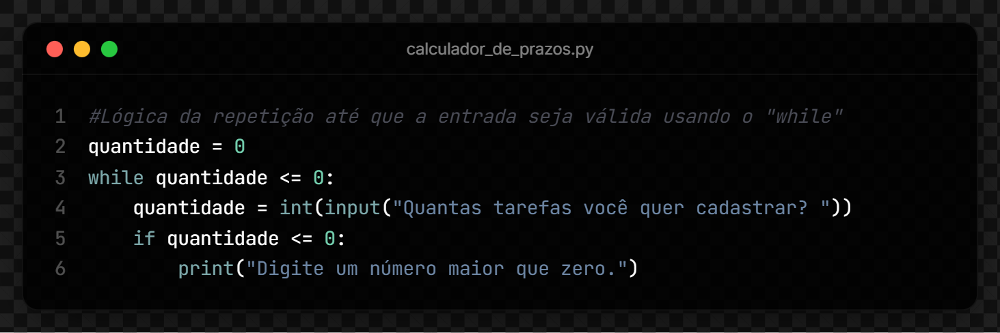

### Cadastro e classificação (`for` e `if/elif/else`)

Um `for numero in range(1, quantidade + 1)` repetia o cadastro para cada tarefa. A resposta "s" ou "S" virava o booleano `concluida`, e a cadeia `if/elif/else` definia o status e somava no contador correspondente.


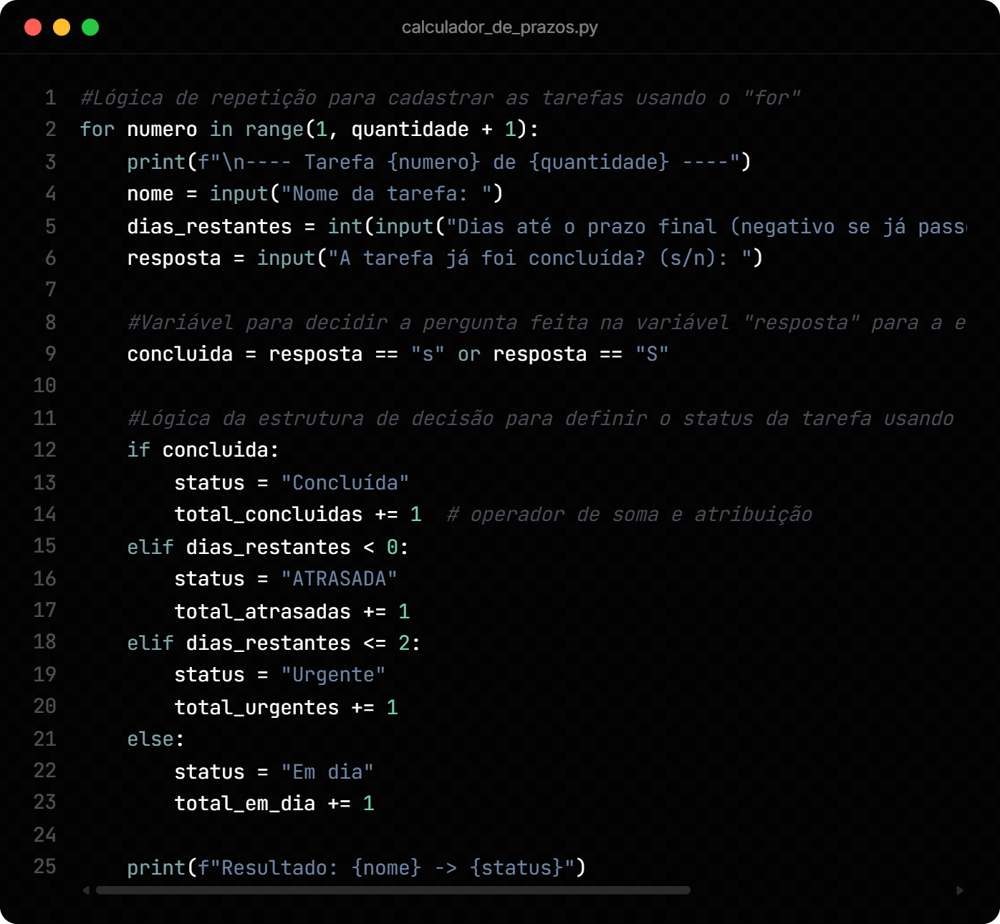

### Resumo final

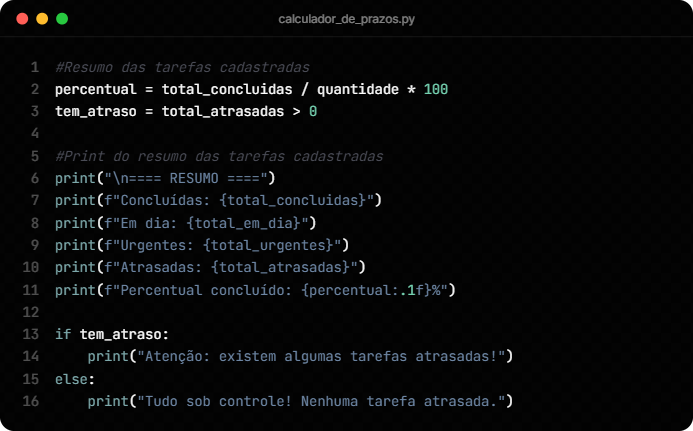

**Limitação:** só sobravam os contadores. O nome e o prazo de cada tarefa eram perdidos.

---

## Versão 2: listas e funções

### Antes e depois

| | ❌ Versão 1 | ✅ Versão 2 |
| --- | --- | --- |
| **Estrutura** | Um único bloco de código | Funções com uma responsabilidade cada |
| **Armazenamento** | Só contadores (`total_concluidas`...) | Listas (`nomes`, `dias`, `status_lista`) |
| **Status da tarefa** | `if/elif/else` dentro do `for` | Função `definir_status()` com `return` |
| **Contagem** | `+= 1` durante o cadastro | `sum()` sobre `status_lista`, sob demanda |
| **Interação** | Roda uma vez e encerra | Menu em loop |
| **Dados após o cadastro** | Perdidos | Ficam nas listas e podem ser listados |

### 1. Guardar os dados: contadores → listas

Três listas paralelas: a posição `i` guarda o nome, o prazo e o status da mesma tarefa. A regra de status virou a função `definir_status()`, que recebe a conclusão e os dias restantes e **devolve** o status.


### 2. Cadastro: `cadastrar_tarefas()`

O `while` e o `for` foram para dentro de uma função. Cada tarefa é guardada nas listas com `append()`, e o status vem de `definir_status()`.


### 3. Consultas: listar, status e resumo

- `listar_tarefas()` percorre as listas e mostra cada tarefa.
- `ver_status()` conta quantas tarefas existem em cada status.


- `mostrar_resumo()` calcula o percentual concluído e avisa se existe tarefa atrasada.

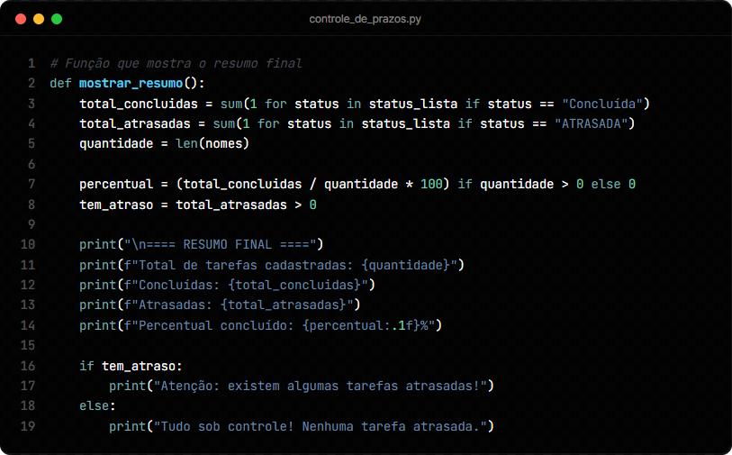

### 4. Programa principal: menu em loop

Um `while True` pergunta o que o usuário quer fazer e só termina quando ele escolher finalizar.

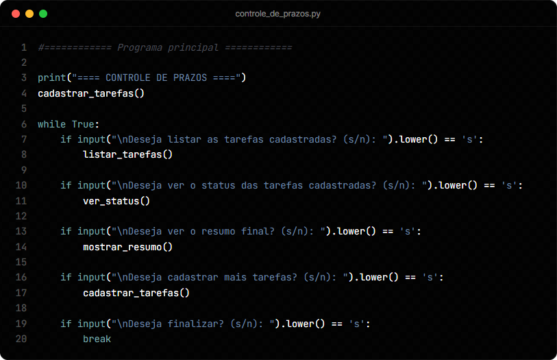

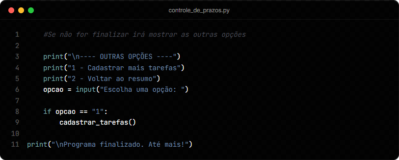

**Limitações:** texto no lugar de número encerrava o programa com erro, e as tarefas se perdiam ao fechar.

---

## Versão 3: versão final

### Antes e depois

| | ❌ Versão 2 | ✅ Versão 3 |
| --- | --- | --- |
| **Entrada inválida** | `int(input(...))` quebra com texto | `ler_numero()` com `try`/`except` repete a pergunta |
| **Persistência** | Tarefas perdidas ao fechar | Salvas em `tarefas.txt` e carregadas ao abrir |
| **Editar e remover** | Não existia | `editar_tarefa()` e `remover_tarefa()` |
| **Menu** | Perguntas s/n em sequência | Menu numerado de 0 a 6 |
| **Listas** | `nomes`, `dias`, `status_lista` | Nova lista `concluidas`, para recalcular o status ao editar |

### 1. Entradas inválidas: `ler_numero()`

Se o usuário digitar texto, o `int()` lança `ValueError`. O `except` captura o erro, avisa e o `while` pergunta de novo. A função substituiu todos os `int(input(...))` do programa.

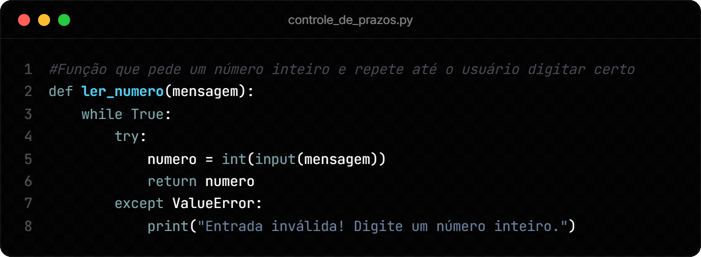

### 2. Salvar em arquivo: `salvar_tarefas()`

Grava uma tarefa por linha em `tarefas.txt`, no formato `nome;dias;concluida`. É chamada depois de cadastrar, editar ou remover.

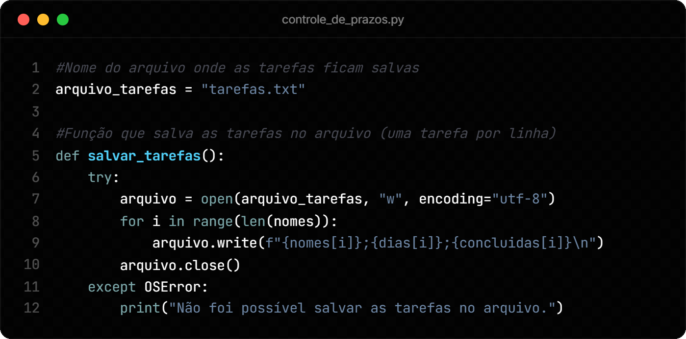

Exemplo do conteúdo de `tarefas.txt`:

```text
Prova final;1;False
Relatório;10;True
```

### 3. Carregar do arquivo: `carregar_tarefas()`

Lê o arquivo ao abrir o programa e devolve cada linha para as listas. O `try`/`except` trata dois casos: arquivo que ainda não existe (`FileNotFoundError`, começa com a lista vazia) e linha inválida (`ValueError`, a linha é ignorada).

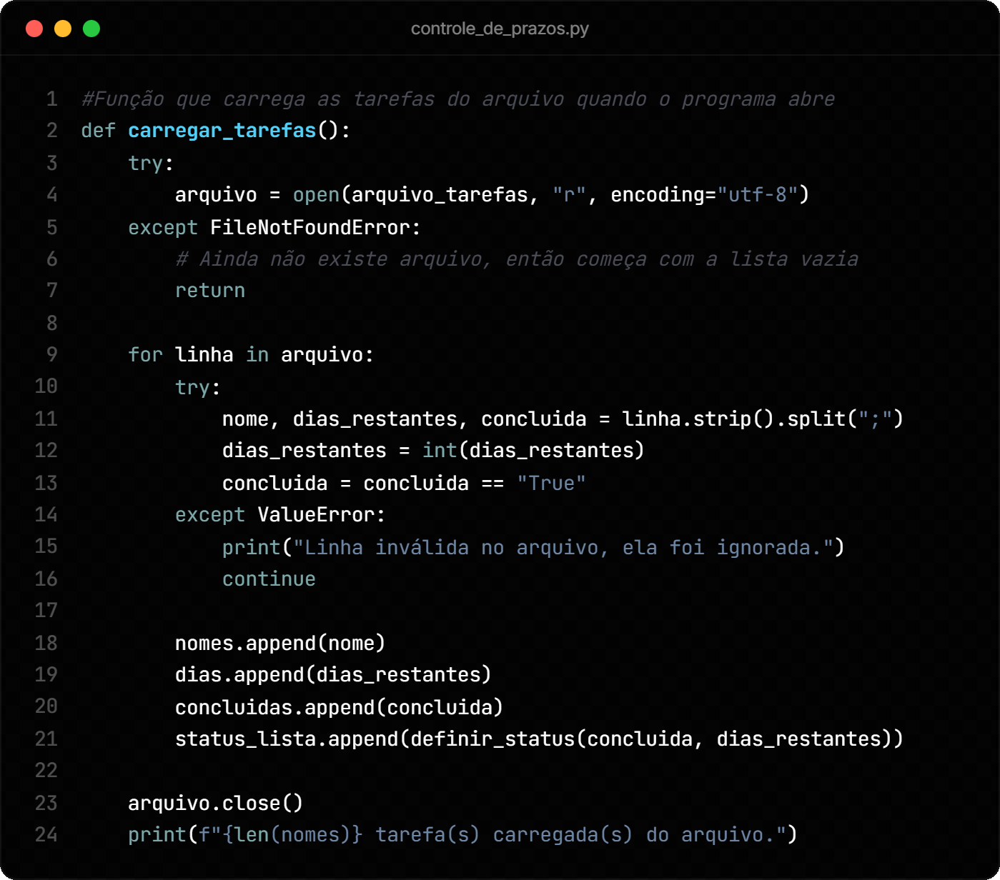

### 4. Editar uma tarefa: `editar_tarefa()`

Primeiro o usuário escolhe a tarefa pelo número e o que quer mudar: nome, dias ou se foi concluída.

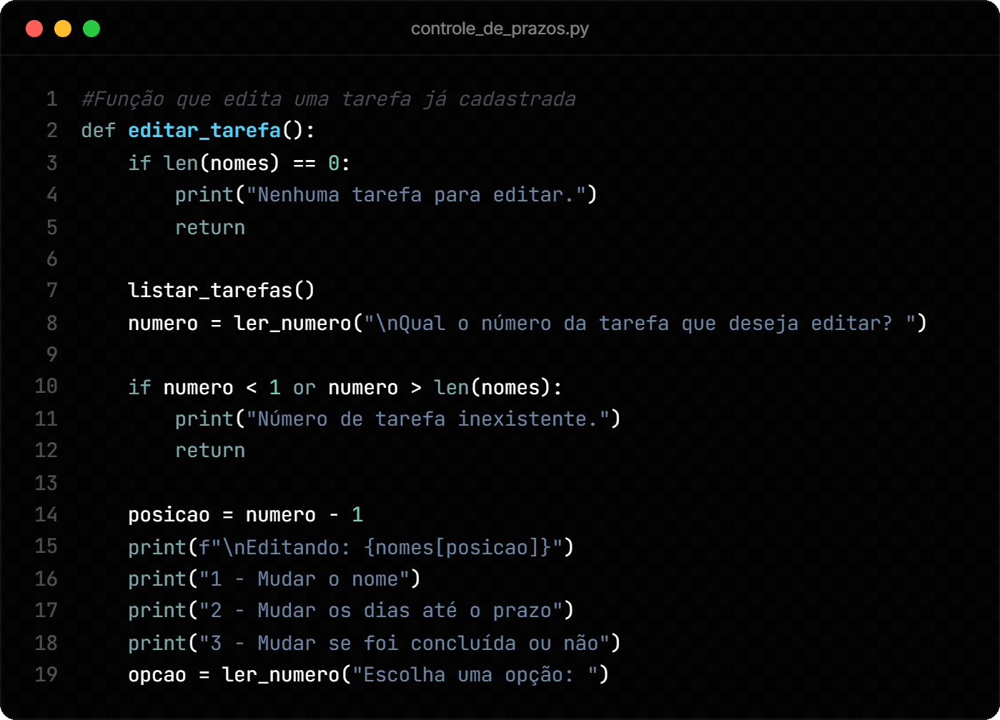

Depois o valor é alterado, o status é recalculado com `definir_status()` e o arquivo é salvo.

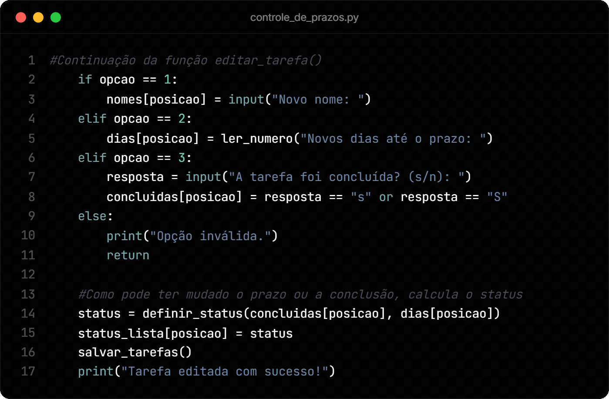

### 5. Remover uma tarefa: `remover_tarefa()`

Usa `pop()` na mesma posição das quatro listas, para elas não ficarem desalinhadas. Depois salva o arquivo.

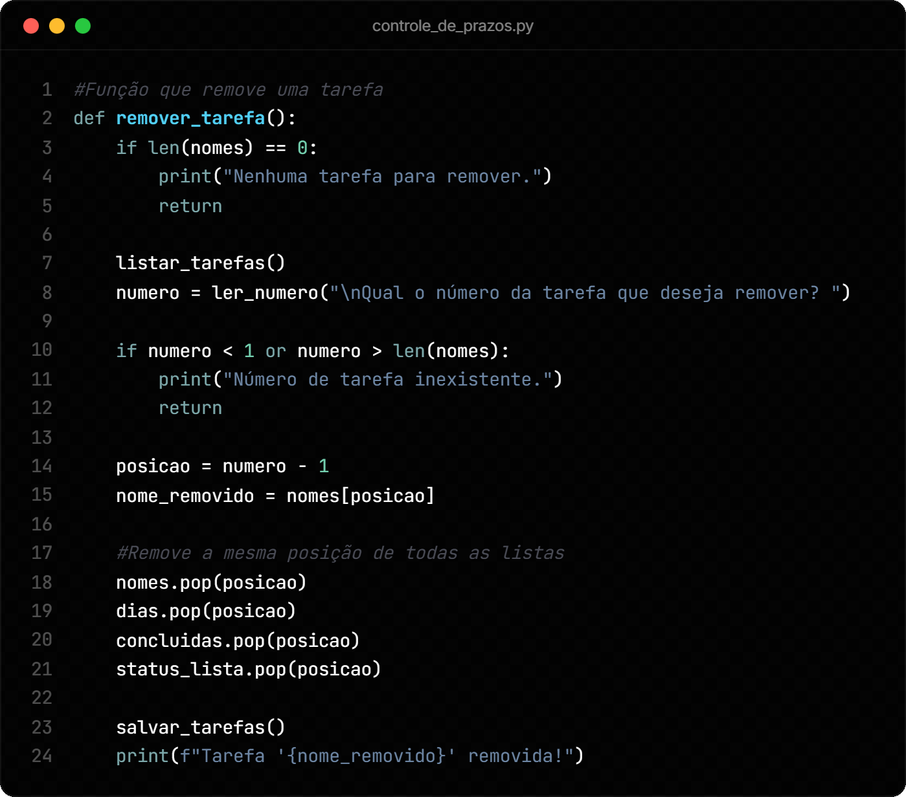

### 6. Programa principal: menu numerado

Um `while True` com `if/elif` chama a função de cada opção (1 a 6) e termina com a opção 0.

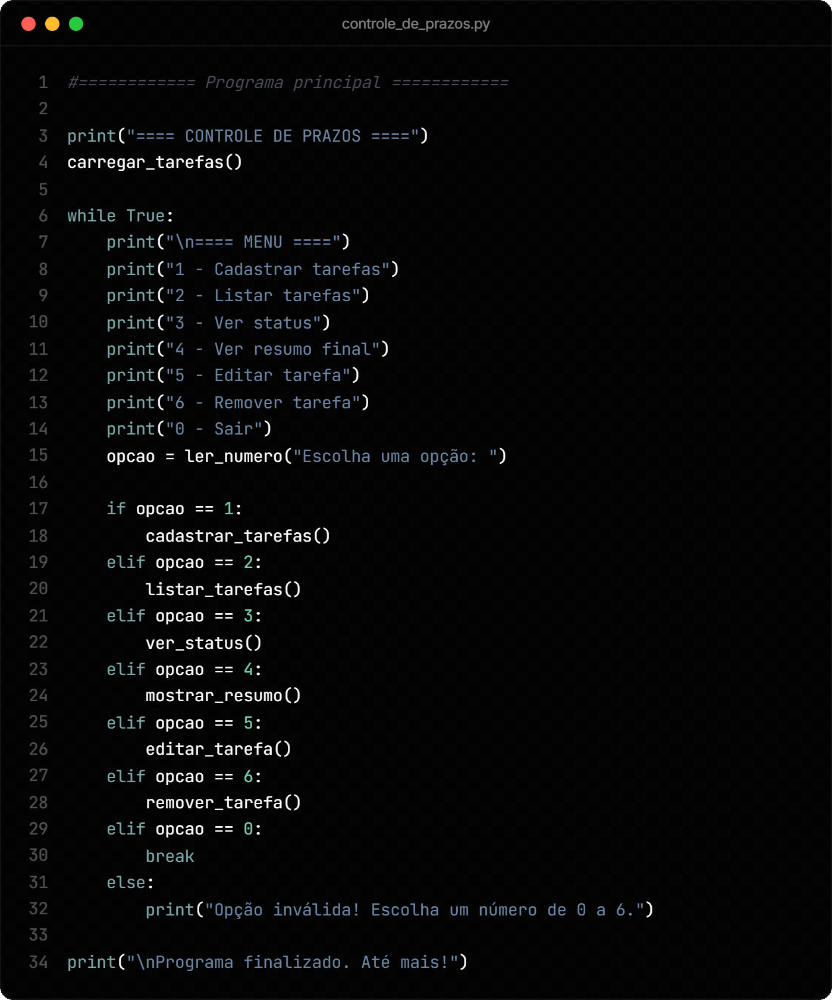

---

## Limitações atuais

- Os dias são salvos como número. Se o programa for aberto em outro dia, o prazo não diminui sozinho.
- Um `;` no nome da tarefa quebra a linha no arquivo.
- Nas perguntas de sim/não, qualquer resposta diferente de "s" ou "S" conta como "não".

## Próximos passos

- ~~Refatorar o código usando funções.~~ ✅
- ~~Guardar as tarefas em listas.~~ ✅
- ~~Tratar entradas inválidas com `try`/`except`.~~ ✅
- ~~Salvar as tarefas em arquivo.~~ ✅
- ~~Permitir editar e remover tarefas.~~ ✅
